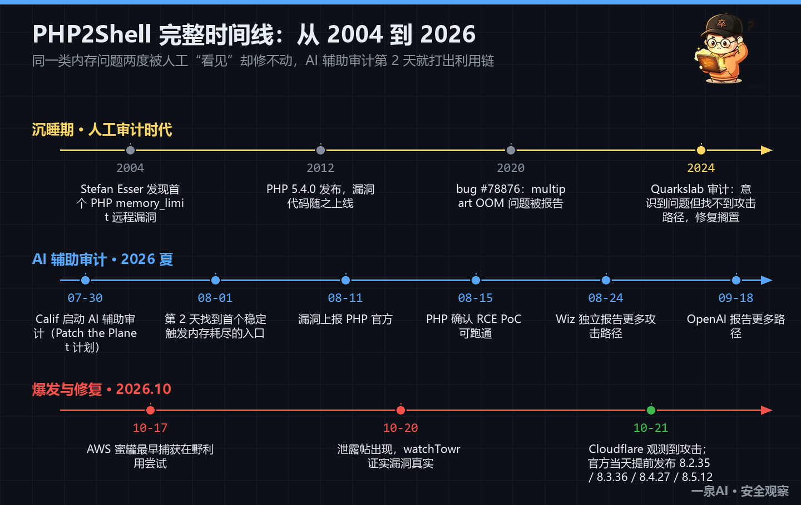
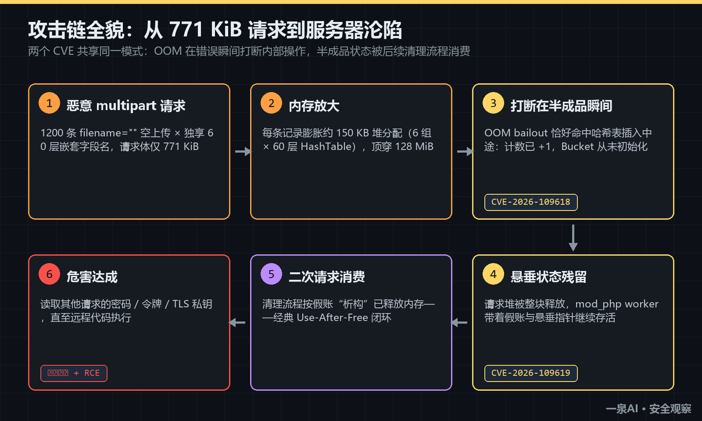
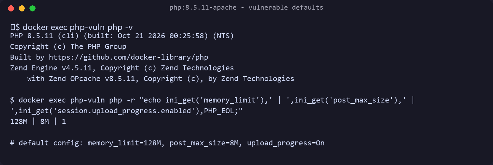
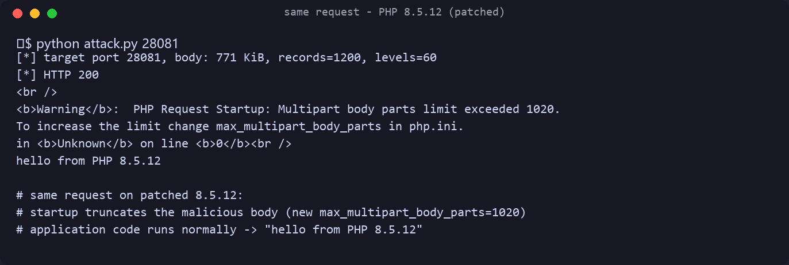
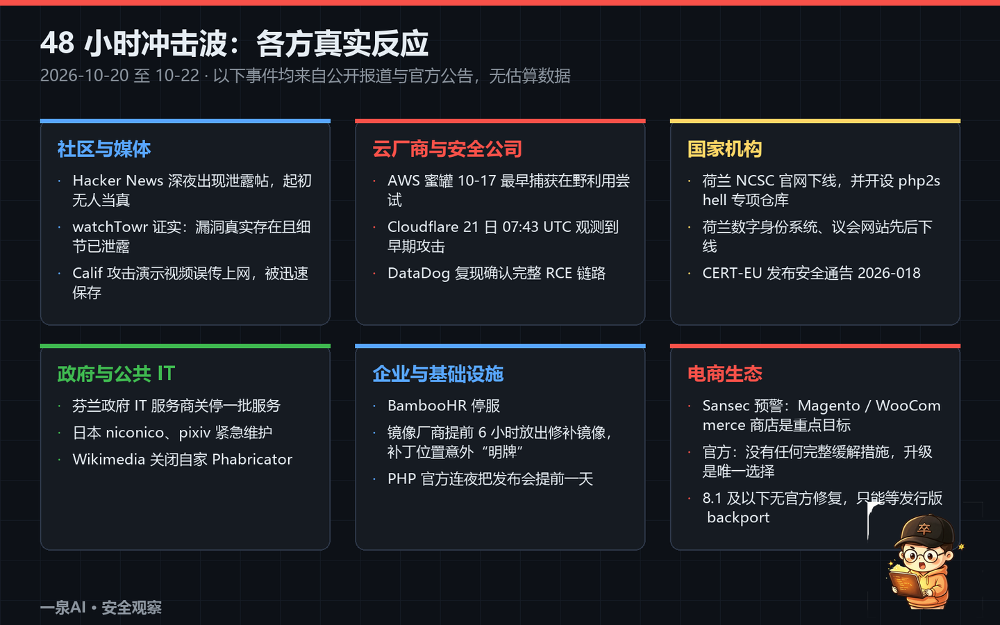

PHP 被爆出两个9.2 分的PHP2Shell 漏洞，原理是什么？该如何防御？

2026 年 10 月 21 日，PHP 官方紧急发布了 8.2.35 / 8.3.36 / 8.4.27 / 8.5.12 四个安全版本，修复两个 CVSS v4.0 评分 9.2 的远程代码执行漏洞（CVE-2026-109618、CVE-2026-109619，统称 PHP2Shell）。官方公告的措辞罕见地强硬：没有任何完整的缓解措施，升级是唯一安全的选择。

这两个漏洞值得认真讨论，原因有三：它们影响 PHP 5.4 到 8.5 之间几乎所有版本（漏洞代码最早可追溯到 2012 年）；攻击者无需任何账号密码，且请求在你的业务代码运行之前就触发了漏洞；发现过程标志着 AI 辅助漏洞挖掘进入了一个新阶段——2024 年人工审计认为"理论上可利用但找不到路径"的问题，2026 年AI 辅助审计两天就打出了利用链。
我在本地 Docker 里用漏洞版本和修复版本做了对照复现，该文把根因、复现方法和防御方案整理出来。内容基于 Calif、Wiz、Sansec、DataDog 等一手技术报告和我自己的实测，供参考。
先放一张完整时间线，帮助理解后文的来龙去脉：



## 一、漏洞的本质：两本记错了的"内存账"

PHP 解释器用C 编写，内存管理靠手工记账。两个漏洞共享同一个失败模式：
一次致命的内存耗尽错误（OOM fatal）在错误的时间点打断了PHP 的内部操作——记账了、活没干完，而后面的清理程序拿着这本假账，把已经释放或从未初始化的内存当成正常数据继续使用。
这正是 Use-After-Free（UAF）的经典形态。差别在于"账"记在哪：

>CVE-2026-109618 出在 Zend 引擎的哈希表插入函数 _zend_hash_str_add_or_update_i()。它的操作顺序是先把存活计数器 nNumUsed/nNumOfElements 加 1，然后才分配并初始化新 Bucket 的 key。如果分配 key 的那一步恰好撞上 memory_limit、触发bailout，后续初始化全部跳过，但计数器已经加上去了。等哈希表销毁时，zend_array_destroy() 按计数器逐个"析构"Bucket——包括那个从未初始化的。陈旧内存里的随机字节被当作合法的 zval 指针和类型信息处理，攻击者预先布置好内存内容即可借机制控读写。

>CVE-2026-109619 出在 Session 上传进度功能。它会在 PHP 还在解析 multipart 请求体时（早于模块正常激活）提前初始化 Session，此时 Session 全局变量里存的是指向当前请求堆的指针。如果解析中途发生 OOM 致命错误：END 清理回调被跳过、模块关闭钩子被激活标志挡在门外，但请求堆照样被整块释放。Apache mod_php 的 worker 进程带着 PS(id)、PS(http_session_vars) 两个悬垂指针存活下来，攻击者再发一个不带文件、但带 Session ID 和 PHP_SESSION_UPLOAD_PROGRESS 字段的请求，就能让清理路径去"析构"一块早已释放的内存。PHP-FPM 在启动失败时会直接退出 worker，看似免疫，但 Calif 找到了经 unserialize() 簿记结构（分配在请求堆、发布到扩展全局区）的残留路径，通过负数的待析构计数控制指针写入位置——FPM 下同样可达 RCE。
两个漏洞都还附赠一个类 Heartbleed 的内存泄露面：上传进度处理器可把已释放的 worker 内存通过 PHPSESSID 响应 cookie 送回客户端，其中可能包含其他请求的密码、令牌、API 密钥甚至TLS 私钥，且不需要应用调用session_start()。

## 二、攻击者如何"制造"那次致命错误

这类漏洞沉睡 14 年的原因之一，是"在任意想要的时刻让内存分配失败"本身并不显然。Calif 找到的放大器很巧妙：

• post_max_size（默认 8M）只校验请求头声明的 Content-Length，不校验 PHP 实际消费的字节数；

• 一个 filename="" 的 RFC1867 空文件上传字段不含文件数据、不计入 max_file_uploads，但 PHP 仍会为它创建 name, full_path, type, tmp_name, error, size 六个 $_FILES 条目；

• 如果字段名是深层嵌套的（如 files[a][b][c]...），每一层都要为六个条目分别建 HashTable、Bucket 和字符串键。

几百条这样的记录，HTTP 体不到 8 MiB，却能在 PHP 堆里膨胀出超过 128 MiB 的分配——攻击者由此获得一个"可控 OOM"的遥控器，再去精确打断前面说的那些半成品操作。
把上面两个环节串起来，完整攻击链如下（两个CVE 对应第③④步）：



## 三、本地复现：漏洞版与修复版的对照实验

以下实验仅仅在Docker 容器里（勿在正式环境尝试）进行从复现到"触发echo执行"为止，不包含完整 RCE 链。
环境是修复版发布前的最后一个版本 php:8.5.11-apache，容器里只放一个一行脚本：
```
docker run -d --name php-vuln -p 28080:80 php:8.5.11-apache
echo '<?php echo "hello from PHP " . PHP_VERSION;' > index.php
docker cp index.php php-vuln:/var/www/html/index.php
```



默认配置 memory_limit=128M、post_max_size=8M、上传进度开启，正是漏洞要求的出厂状态。然后构造 1200 条空上传记录、每条独享 60 层嵌套字段名（这里有个我踩过的坑：如果多条记录共用同一条嵌套路径，PHP 只会把层级建一遍，压力上不去）：

```
import http.client

BOUNDARY = "----php2shellpoc"
parts = []
for i in range(1200):
    nest = "".join(f"[k{d}r{i}]" for d in range(60))
    parts.append(
        f"--{BOUNDARY}\r\n"
        f'Content-Disposition: form-data; name="files{nest}"; filename=""\r\n'
        f"Content-Type: application/octet-stream\r\n\r\n\r\n"
    )
body = ("".join(parts) + f"--{BOUNDARY}--\r\n").encode()

conn = http.client.HTTPConnection("127.0.0.1", 28080, timeout=120)
conn.request("POST", "/index.php", body=body,
             headers={"Content-Type": f"multipart/form-data; boundary={BOUNDARY}"})
print(conn.getresponse().read().decode(errors="replace"))

```


实测结果：请求体仅 771 KiB，探针显示每条记录约膨胀 150 KB 堆分配，1200 条直接顶穿 128 MiB——PHP 返回 Fatal error: Allowed memory size of 134217728 bytes exhausted ... in Unknown on line 0。注意 Unknown on line 0：错误发生在引擎解析请求体阶段，index.php 里那行 hello 根本没机会执行。

同一个请求打到修复后的 php:8.5.12-apache，行为完全不同：启动阶段直接报 Warning: PHP Request Startup: Multipart body parts limit exceeded 1020，恶意请求体被截断，随后 "hello from PHP 8.5.12" 正常输出。这个警告还透露了修复方案的一部分：8.5.12 新增了 max_multipart_body_parts 限制（默认 1020），在请求启动阶段就掐断放大器。

如实说明边界：我连续打了 6 轮同样请求，worker 没有崩溃——从"可控OOM"到稳定RCE 还隔着 heap grooming、内存布局勘测和类型混淆载荷，这是利用技术中最难的部分，也是 Calif 与 Wiz 原始报告里最硬核的内容。

## 四、影响面

披露48 小时内各方反应一览（均有公开报道或官方公告）：



    • 版本：PHP 5.4.0（2012 年）至 8.5.x 全部受影响；修复版本为 8.2.35 / 8.3.36 / 8.4.27 / 8.5.12；8.1 及以下已停止官方支持，仅有 7.4 / 8.0 / 8.1 的最小源码补丁，依赖发行版或厂商 backport。
    • 部署形态：mod_php、PHP-FPM、php-cgi、FrankenPHP、LiteSpeed 等所有面向 Web 的 SAPI 全部在射程内，默认配置即可触发，mod_php 风险最高。
    • 应用：Calif 演示了 WordPress、Drupal、Joomla、MediaWiki、Roundcube、Magento、phpMyAdmin、Nextcloud、Laravel、Symfony、WHMCS 默认安装下的 pre-auth RCE。这是引擎层漏洞，应用代码写得再干净也防不住。
    • 在野情况：AWS 蜜罐在10月17 日（公开前 4 天）就捕获利用尝试；Cloudflare 在补丁发布前 6 个多小时观测到早期攻击。披露当天荷兰、芬兰、日本等多国机构选择预防性下线。
    • 容易被忽略的面：路由器、NAS、防火墙管理后台等内嵌 PHP 的设备，管理员往往没有直接升级 PHP 的入口。

## 五、防御与检测

唯一彻底的方案是升级：

1. 升级到 8.2.35/8.3.36/8.4.27/ 8.5.12，或使用发行版/厂商backport（注意厂商backport后版本号可能不变，以厂商公告为准）；

2. 容器部署需要重建镜像、重新部署，并重启所有仍在跑旧运行时的 worker——只更新镜像不重启等于没修；

3. 盘点时不要只看命令行 php -v：Web 运行时可能来自不同的包或容器镜像；也别忘了嵌入式设备。

临时缓解（官方强调都不完整，只能买时间）：

• 在 nginx/Apache 层拦截 multipart/form-data 请求（所有已知触发路径都走 multipart），代价是文件上传全挂；

• 只允许 GET/HEAD 的只读模式，或直接停掉 PHP-FPM 挂静态维护页（应用自带的"维护模式"没用，因为解析请求体早于应用代码）；

• session.upload_progress.enabled = 0 配合 memory_limit = -1（PHP 8.5 再加 fatal_error_backtraces = 0）。两个坑：memory_limit = -1 等于拆掉保险丝，需配合前端请求体限制和容器内存限额；不要用 RLIMIT_AS/RLIMIT_DATA 这类进程级限制替代——它们恰恰会制造漏洞依赖的分配失败。

检测狩猎（DataDog 给出的方向）：日志中异常巨大的表单提交和嵌套字段名离谱的 multipart 请求；请求初始化阶段的 memory exhaustion 错误；worker 段错误集中爆发；Web 进程派生出意料之外的 shell 子进程。荷兰 NCSC 的专项仓库（http://github.com/NCSC-NL/php2shell）在持续更新检测规则与受影响软件清单。

## 六、最后的思考

这次事件里有两组数字值得放在一起看：2024年，核心开发者在审计中意识到同类问题存在，但找不到利用路径，修复在方案拉扯中搁置；2026 年，AI 辅助审计从启动到找到第一个可利用入口只用了两天，而全球协同修复花了整整两个月
发现漏洞的成本正在崩塌，修复漏洞的成本没有。OpenAI 表示PHP 这两个漏洞只是他们已经发现、正在修的多个重大漏洞之一；Anthropic 公布其模型一年内在开源项目中扫出近3 万条候选线索。对防守方来说，最现实的启示大概是：知道自己跑着什么版本、能在几小时内完成升级，正在从"运维基本功"变成"核心安全能力"。那些十几年没人登录过的PHP老后台，在慢世界里可以安稳很多年，在这个新世界里就是活靶子。
